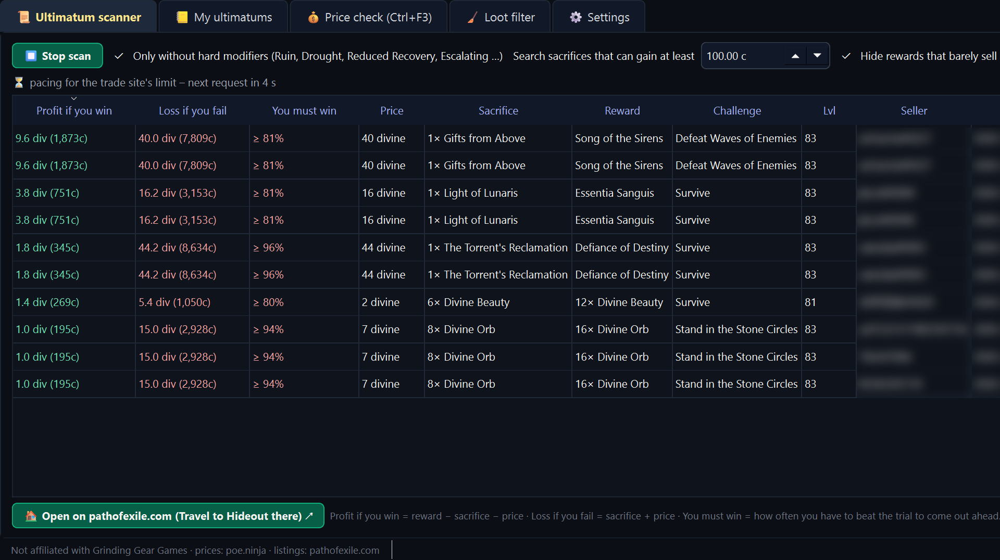
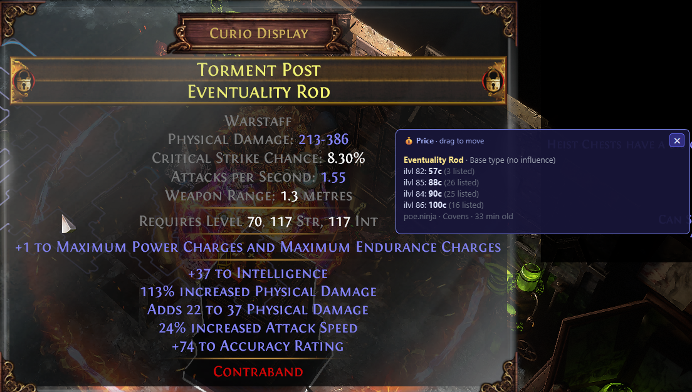
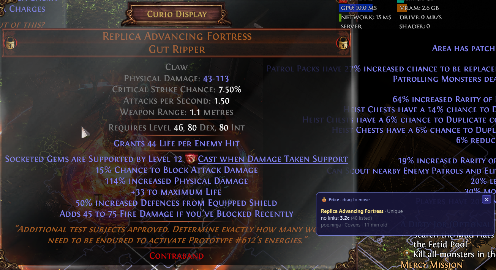
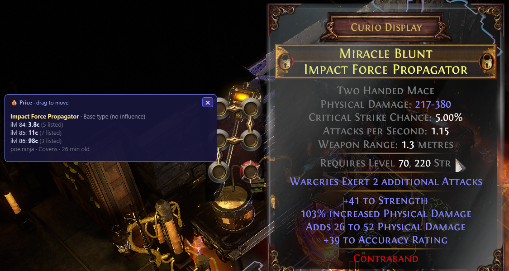
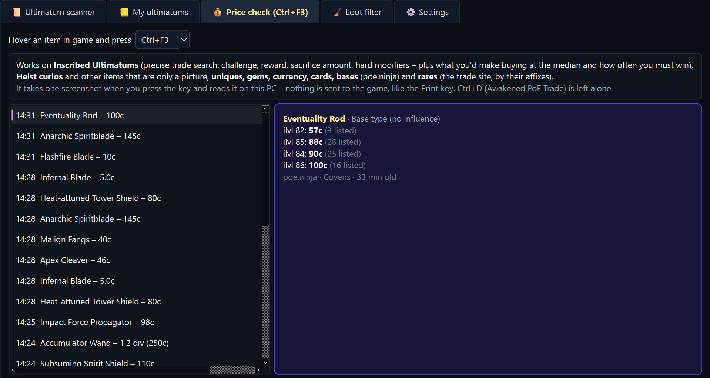
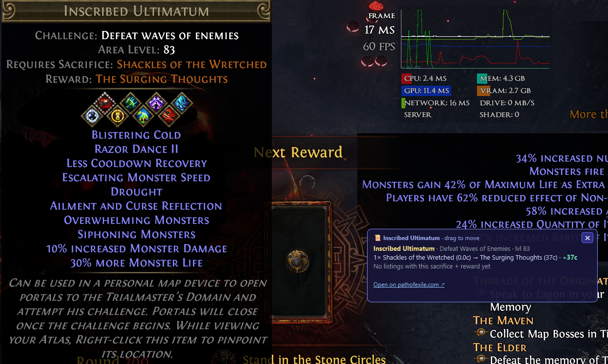
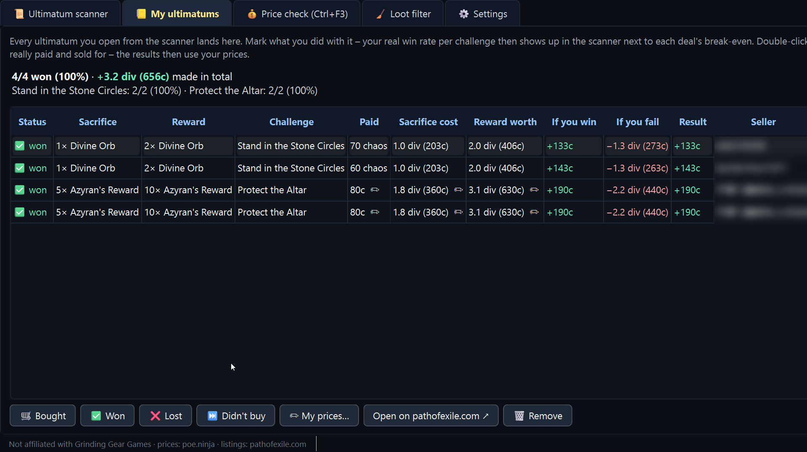
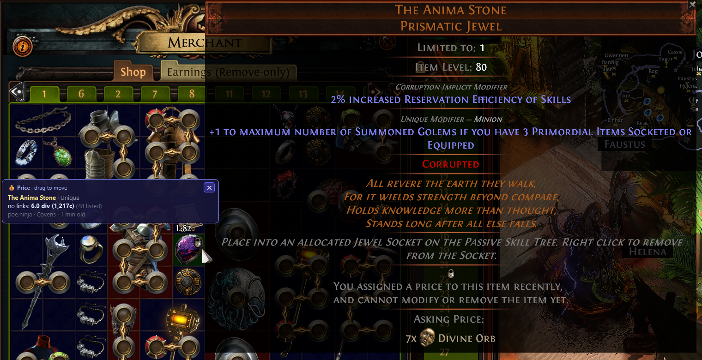

# Trialmaster's Ledger

**Inscribed Ultimatum scanner, Heist curio price check and deal tracking for Path of Exile 1.**
A small Windows desktop app (Python + Qt) that tells you which Inscribed Ultimatums are worth buying, how often you'd have
to win them to come out ahead, what that **Heist curio** on the display is worth – and keeps score of how you actually do.



## What it does

| Tab | |
|---|---|
| 📜 **Ultimatum scanner** | Scans **Instant Buyout** Inscribed Ultimatums on the trade site in the background and ranks them by **profit if you win**, **loss if you fail** and **how often you must win** to break even. Values come from poe.ninja. Checks the expensive end (chase uniques like Defiance of Destiny), every sacrifice stack size (4× / 8× Divine …), the unique rewards it has seen and the newest listings every 10 minutes. 🔥 + a beep for new steals. Double-click → that seller's listing on pathofexile.com, *Travel to Hideout* there. |
| 📒 **My ultimatums** | Every deal you open is remembered. Mark it bought / won / lost, enter what you **really** paid and sold for, and you get your win rate per challenge and the chaos you actually made. The scanner then shows *your* win rate next to each deal's break-even. |
| 💰 **Price check (Ctrl+F3)** | Hover an item in game and press **Ctrl+F3**: Inscribed Ultimatums (precise trade search + what you'd make buying at the median), **Heist curios** and other picture-only items (read from the screen), uniques, gems, currency, cards, bases (poe.ninja) and rares (trade site, by their affixes). |
| 🧹 **Loot filter** | Writes `TrialmastersLedger.filter`: NeverSink's filter + poe.ninja price tiers for your league (refreshed hourly), and big gold Chaos Orbs. |
| ⚙ **Settings** | League, your own list of ultimatum modifiers you don't want to run, optional trade login. |

### 🗝 Heist curios

Curios on a Heist reward display are only a picture – you can't Ctrl+C them, so most price checkers can't read them.
Hover the curio and press **Ctrl+F3**: the app reads the tooltip straight off the screen (offline OCR on your PC) and
shows the poe.ninja price next to it – replica uniques, uniques, gems, currency, and the Heist-only bases (Eventuality Rod,
Impact Force Propagator, Accumulator Wand …) by item level. Every check stays in the list, so after a blueprint you can see
at a glance which curio was worth taking.



| | |
|---|---|
|  |  |



> Rare curios are priced as their **base type** – what the base is worth for crafting at each item level. A rare with
> great affixes can be worth more; use the trade site for those.

### 📜 Ctrl+F3 inside the Ultimatum

Hover the Inscribed Ultimatum (also mid-trial) and press Ctrl+F3: sacrifice → reward with their values, what the same
ultimatum sells for and how often you'd have to win.



Smart bits:

* **Hard modifiers are yours to pick** (Ruin, Drought, Escalating … or none) – marked ⚠, optionally hidden.
* **Prices that aren't real are caught**: cards nobody trades (< 5 sold a day), prices pumped > 300 % this week, uniques with < 10 listings, and cards poe.ninja prices far above what their set turns into.
* **Divination card turn-ins**: what a full set becomes and what that's worth, next to the card price (e.g. 9× Azyran's Reward → a random corrupted unique Prismatic Jewel: Anima Stone, Watcher's Eye …).
* Searches that never turn up a 100c+ deal are rested for 12 h, so the budget goes where the money is.

| | |
|---|---|
|  |  |

## Install

1. Install **Python 3.10+** from [python.org](https://www.python.org/downloads/) (tick *Add Python to PATH*).
2. Download this repo (*Code → Download ZIP*) and unzip it anywhere.
3. Double-click **`run_trialmasters_ledger.bat`**. The first start installs the packages into `.venv` (a minute or two).

Windows only for the in-game hotkey; the rest runs anywhere Qt does.

## ⚠ Rate limits – please read

The trade site limits searches **per internet connection (IP) and per account, not per app**. The app reads the limits the
site sends with every answer and only ever uses about **half** of each short window (¾ of the 3-hour one), leaving room
for your browser and Awakened PoE Trade.

But if **several people on the same connection** (household, dorm, shared VPN exit) run it, or you hammer the trade site
in a browser at the same time, you all share **one** budget: the scanner slows down or pauses, and the site can answer
*"too many requests"* and lock searches for a while (up to an hour). The app backs off by itself – if it says it's
paused, let it wait. Please don't try to get around the limits (VPN hopping etc.); that's against GGG's rules.
poe.ninja can be busy now and then too; the last known prices are used meanwhile.

## Playing by the rules

* It **never touches the game**: no key presses, clicks, macros or memory reading. A price check is one screenshot per key
  press, read on your PC – like the Print key.
* Buying happens on pathofexile.com as usual (*Travel to Hideout*). The app never whispers or trades for you.
* The optional POESESSID is stored only on your PC (`%APPDATA%\PoECompanion\poesessid.txt`), never logged, never sent
  anywhere but pathofexile.com. Never share it.

## Your data

`config/` (settings, deal history, caches) and `logs/` stay on your PC and are git-ignored.

## Development

```
python -m venv .venv
.venv\Scripts\pip install -r requirements.txt
.venv\Scripts\python -m pytest tests
```

## Credits

Prices: [poe.ninja](https://poe.ninja) · listings: [pathofexile.com](https://www.pathofexile.com/trade) ·
base filter: [NeverSink](https://github.com/NeverSinkDev/NeverSink-Filter) (MIT) · divination card rewards:
[poewiki.net](https://www.poewiki.net) (CC BY-NC-SA, downloaded at runtime) · unique tier list: [poedb.tw](https://poedb.tw/us/Inscribed_Ultimatum) ·
OCR: [RapidOCR](https://github.com/RapidAI/RapidOCR).

This product isn't affiliated with or endorsed by Grinding Gear Games in any way.

## License

[MIT](LICENSE)
